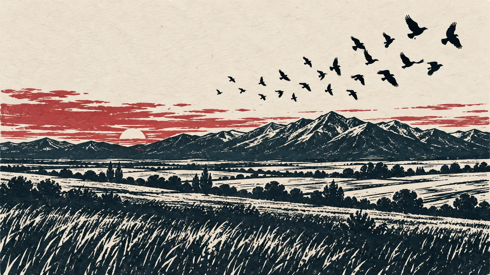

# Field of Blackbirds

An illustrated, animated scroll through the history of Kosovo, from the first farmers around 6000 BC to today.



**Live site:** https://david-x3d.github.io/kosovo-history/

## What's on the page

Kosovo takes its name from *kos*, the Serbian word for blackbird. The site is built around that image.

- **Blackbirds on the title.** A flock circles over a dusk sky and some birds perch on the letters. Move your pointer near them and they fly off. They come back later.
- **A year counter.** It counts through the eras as you scroll, from 6000 BC to 2026. The background colour changes for each era.
- **Linocut prints.** Seven illustrations shown as signed paper prints. Each one reveals as it scrolls into view.
- **Place names in three languages.** A switch in the corner shows town names in English, Albanian or Serbian (Prishtina / Priština, Deçan / Dečani and so on).
- **Small scenes.** Peony petals drift in the 1389 section. The NEWBORN letters from 2008 repaint when you click them.

## Eras covered

| Period | Section |
| --- | --- |
| c. 6000 – 3000 BC | First farmers and the Goddess on the Throne |
| c. 400 BC – AD 600 | Dardania and Rome, Ulpiana |
| 1180s – 1455 | Medieval Serbia, monasteries, Novo Brdo silver |
| 28 June 1389 | The Battle of Kosovo |
| 1455 – 1912 | Ottoman rule, Prizren, the League of Prizren |
| 1912 – 1945 | Balkan Wars and the world wars |
| 1945 – 1989 | Yugoslav Kosovo, the university, the 1981 protests |
| 1989 – 1999 | Loss of autonomy, the parallel state, war |
| 1999 – 2008 | UN administration |
| 2008 – today | Independence and after |

## A note on the content

Albanians and Serbs often remember Kosovo's history differently. The text sticks to what historians broadly agree on and says where they don't. Casualty and displacement figures are rounded estimates, and sources differ. The page ends with a list of further reading.

The illustrations are modern linocut-style images made for this site with AI image generation. They are not historical artworks and do not show real people.

## Running it

It's a single static page with no build step and no dependencies apart from Google Fonts. Open `index.html` in a browser, or serve the folder:

```bash
python3 -m http.server 8000
```

Then go to http://localhost:8000.

## Files

```
index.html   the whole site: markup, styles and scripts
img/         the seven illustrations (WebP)
```

Animations respect `prefers-reduced-motion`.
